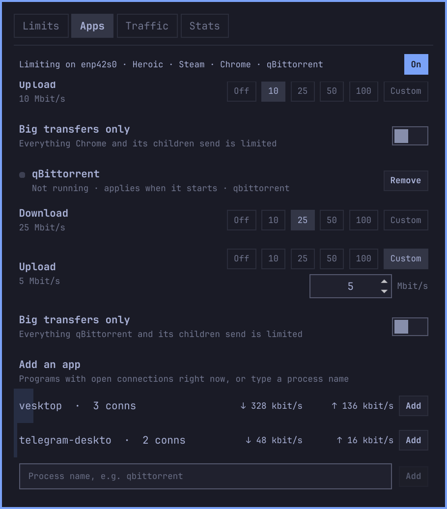
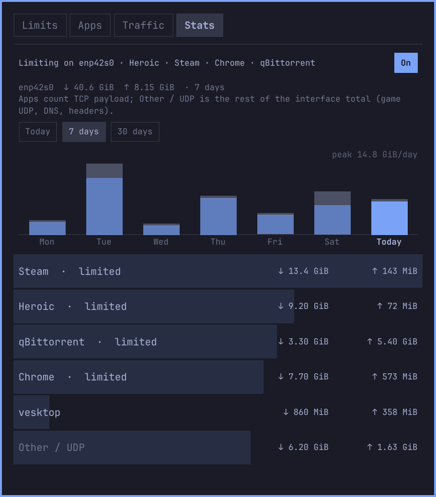

# Throttle — bandwidth limits for Omarchy

Bar widget that caps download/upload for the whole connection or for single
apps — Heroic and Steam built in, plus any other program (Chrome, Vesktop, a
torrent client…) — so one download doesn't wreck your ping while you play, and
shows where your traffic went today, this week and this month.



- **Limits** — global download / upload caps on the default-route interface
  (picked automatically, follows Wi-Fi ↔ Ethernet). **Off / 10 / 25 / 50 / 100**
  Mbit/s or **Custom**.
- **Apps** — per-app caps, matched by the app's systemd cgroup. **Heroic**
  (incl. `legendary` / `gogdl` / `nile`) and **Steam** are always there; add
  any other program from the ones that have connections open right now (one
  click) or by process name (as in `ps -o comm`, e.g. `chrome`, `vesktop`,
  `qbittorrent`). Up to 8 apps; custom ones have a **Remove** chip (click
  twice). **Games-safe** / **Big transfers only** caps only TCP transfers past
  4 MiB, so game UDP, calls and small requests stay fast.
- **Traffic** — live per-app rates (from `ss`, no root) next to the interface
  total.
- **Stats** — how much each app downloaded / uploaded **today**, over **7** or
  **30 days**, with a per-day chart and the interface total. Collected without
  root every 10 s (TCP byte counters from `ss` + `/sys/class/net`); whatever
  the per-app rows don't explain (game UDP, DNS, headers, root daemons) is the
  **Other / UDP** row. Kept for 35 days in
  `~/.local/state/omarchy/yoyo.throttle/stats.json` (a few KB).



**Tab** cycles tabs · **h/l** chips / range · **j/k** rows · **Enter** acts
(adds a suggested app, arms/confirms Remove, focuses the name field) · **p** pauses

Limits persist and re-apply at login and whenever a limited app restarts.

## Requirements

Omarchy + `nftables` and `iproute2`. Shaping needs root once: `install.sh`
puts a root-owned copy of `helper/throttle-helper` (strict argument checks) in
`/usr/local/lib/yoyo-throttle/` and a `sudoers.d` rule for that file only.

## Install

```bash
omarchy plugin add https://github.com/Loafer19/omarchy-throttle --enable
sudo bash ~/.config/omarchy/plugins/yoyo.throttle/scripts/install.sh
```

The panel shows the `sudo` command (with Copy) until the helper is installed.

## Usage

Click the speedometer to open the panel. Right-click pauses/resumes all limits.

Games launched from Steam or Heroic share the launcher's cgroup — Games-safe is
what keeps them fast. To take a Steam game out of Steam's caps entirely, set its
launch options to:

```
systemd-run --user --scope --quiet --collect -- %command%
```

Start limited apps from the app launcher, not a terminal: an app started from
a terminal shares the terminal's cgroup, so it is refused (the Apps tab says
so) rather than capping your shell. Shells, `sudo`, Hyprland, PipeWire and
other session processes can't be added. Per-app Traffic and Stats rows count
TCP only; UDP is in the total.

## Uninstall

```bash
sudo bash ~/.config/omarchy/plugins/yoyo.throttle/scripts/uninstall.sh
omarchy plugin remove yoyo.throttle
rm -rf ~/.local/state/omarchy/yoyo.throttle
```
