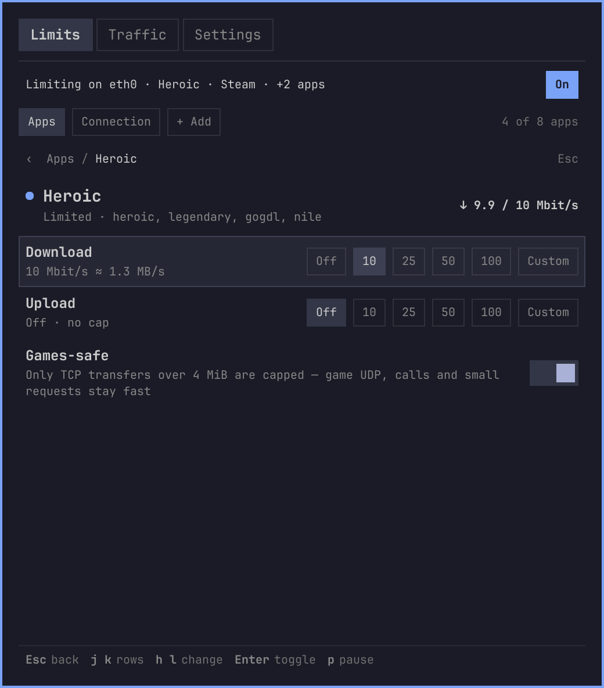
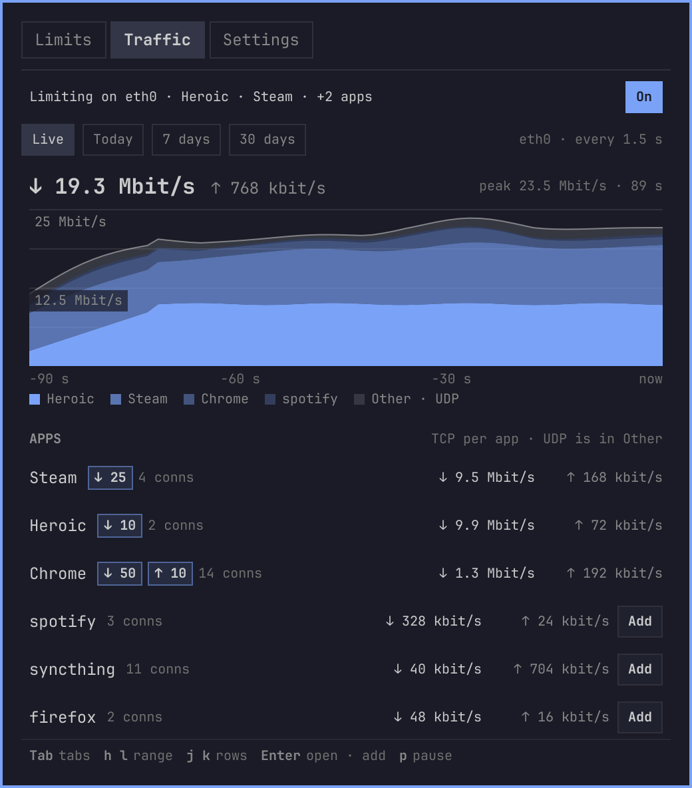
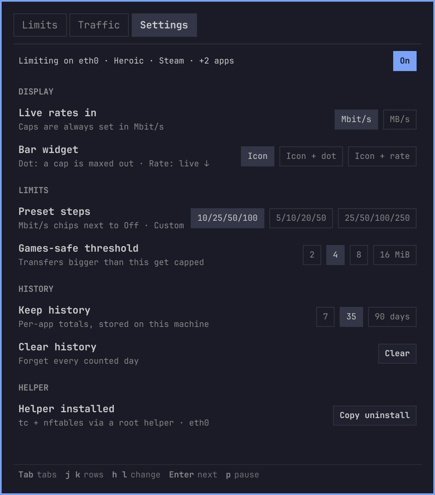
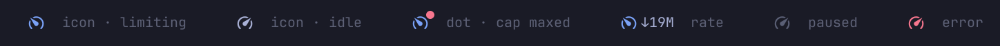

# Throttle — bandwidth limits for Omarchy

Bar widget that caps download/upload for the whole connection or for single
apps — Heroic and Steam built in, plus any other program (Chrome, Vesktop, a
torrent client…) — so one download doesn't wreck your ping while you play, and
shows where your traffic went today, this week and this month.

Two levels of tabs: **Limits** (Apps · Connection · + Add), **Traffic**
(Live · Today · 7 days · 30 days) and **Settings**.

| Limits › Apps | Limits › Apps › Heroic |
| --- | --- |
|  |  |

- **Limits › Apps** — one compact row per app: state dot, what it is doing
  right now and its ↓ / ↑ caps. **Heroic** (incl. `legendary` / `gogdl` /
  `nile`) and **Steam** are always there. **Enter** opens the app: Download
  and Upload caps — **Off / 10 / 25 / 50 / 100** Mbit/s (the steps are
  configurable) or **Custom**, each with an "≈ MB/s" hint — and **Games-safe**,
  which caps only TCP transfers past 4 MiB so game UDP, calls and small
  requests stay fast. Custom apps have a **Remove** chip (press twice).
  Matched by the app's systemd cgroup.
- **Limits › Connection** — download / upload caps for everything on the
  default-route interface (picked automatically, follows Wi-Fi ↔ Ethernet).
- **Limits › + Add** — any other program (Chrome, Vesktop, a torrent
  client…): one of the ones online right now, or by process name (as in
  `ps -o comm`). Up to 8 apps; a new app opens straight in its detail view.
- **Traffic › Live** — the interface total and a stacked per-app chart of the
  last 90 s, then live per-app rates (from `ss`, no root) with their caps and
  an **Add** chip for programs that aren't limited yet.
- **Traffic › Today / 7 days / 30 days** — how much each app downloaded /
  uploaded, with a per-day chart and the interface total. Collected without
  root every 10 s (TCP byte counters from `ss` + `/sys/class/net`); whatever
  the per-app rows don't explain (game UDP, DNS, headers, root daemons) is the
  **Other / UDP** row. Kept for 35 days (7 / 35 / 90 in Settings) in
  `~/.local/state/omarchy/yoyo.throttle/stats.json` (a few KB).
- **Settings** — live rates in Mbit/s or MB/s, the bar widget style, the
  preset steps, the Games-safe threshold (2 / 4 / 8 / 16 MiB, all apps),
  history length, Clear history, and the helper's install / uninstall command.

| Traffic › Live | Traffic › 7 days | Settings |
| --- | --- | --- |
|  |  |  |

**Tab** cycles the top tabs · **h/l** sub-tabs (or the chips of the row under
the cursor) · **j/k** rows (moving up from the first row reaches the sub-tabs)
· **Enter** opens / toggles / acts · **Esc** goes back from an app, then
closes · **p** pauses

**Bar widget** — the speedometer is accent while limits are active, dimmed
while paused and red on an error; its tooltip lists every cap with its live
rate. Settings › Bar widget adds a red **dot** while a cap is maxed out (≥ 90 %)
or the live download **rate** next to the icon (horizontal bars).



Limits persist and re-apply at login and whenever a limited app restarts.

## Requirements

- Omarchy (Quickshell bar) with the plugin system — tested on Omarchy 4.0.
- `nftables` (`nft`) and `iproute2` (`tc`, `ip`, `ss`), `jq`, `sudo`,
  `wl-clipboard` (the Copy chips). All are on a stock Omarchy install.
- Kernel support for `ifb`, `htb` and nftables `socket cgroupv2` matching
  (stock Arch kernels have it) and the unified cgroup v2 hierarchy.
- Shaping needs root once: `install.sh` puts a root-owned copy of
  `helper/throttle-helper` (strict argument checks) in
  `/usr/local/lib/yoyo-throttle/` and a `sudoers.d` rule for that file only.
  Traffic and history need no root at all.

## Install

```bash
omarchy plugin add https://github.com/Loafer19/omarchy-throttle --enable
sudo bash ~/.config/omarchy/plugins/yoyo.throttle/scripts/install.sh
```

The panel shows the `sudo` command (with Copy) until the helper is installed.

## Usage

Click the speedometer to open the panel. Right-click pauses/resumes all limits.

Games launched from Steam or Heroic share the launcher's cgroup — Games-safe is
what keeps them fast. To take a Steam game out of Steam's caps entirely, set its
launch options to:

```
systemd-run --user --scope --quiet --collect -- %command%
```

Start limited apps from the app launcher, not a terminal: an app started from
a terminal shares the terminal's cgroup, so it is refused (Limits › Apps says
so) rather than capping your shell. Shells, `sudo`, Hyprland, PipeWire and
other session processes can't be added. Per-app Traffic rows count TCP only;
UDP is in the total and in Other.

## How it works

- **Who runs what.** `Service.qml` (always loaded) calls
  `scripts/backend.sh` as you. The backend finds each app's processes, maps
  them to their systemd `--user` cgroups and builds a plan; the only
  privileged step is `sudo -n /usr/local/lib/yoyo-throttle/throttle-helper
  apply|clear`, which validates every argument and only touches paths under
  your own `user-<uid>.slice`.
- **Shaping.** Upload: an `htb` tree on the default-route interface.
  Download: ingress is redirected to an `ifb-throttle` device with its own
  `htb` tree. An `nft` table (`yoyo_throttle`) marks packets by cgroup
  (`socket cgroupv2`), and each app's mark lands in its own `htb` class, so
  an app's cap never slows anything else down. Games-safe adds a conntrack
  byte check: only TCP flows that already moved more than N MiB get the mark.
- **When it re-applies.** `backend.sh tick` runs every 5 s and right after a
  settings change; it calls the helper only when the plan's fingerprint
  changed (new cgroup after an app restart, Wi-Fi ↔ Ethernet, new caps), or
  when the shaping vanished (suspend, reboot, someone ran `tc qdisc del`).
- **Traffic.** `backend.sh traffic` diffs `ss -tinpe` byte counters per
  process between calls (`scripts/lib/ss-deltas.awk`); the interface total
  comes from `/sys/class/net/<iface>/statistics`. `stats-sample` adds the
  same deltas to today's totals (`scripts/lib/stats-add.jq`), kept in
  `$XDG_RUNTIME_DIR` and written to `~/.local/state/omarchy/yoyo.throttle/`
  every 5 min and at logout.
- **Settings** live in `~/.local/state/omarchy/yoyo.throttle/settings.json`,
  normalized against `defaults.js` by `scripts/lib/normalize.jq`.

## Troubleshooting

- **"One-time setup" card won't go away** — the helper isn't at
  `/usr/local/lib/yoyo-throttle/throttle-helper`. Run the command from the
  card; it must be run with `sudo` from your normal user.
- **Red status line / red speedometer** — the helper refused or failed;
  the message is the helper's own. `bash scripts/backend.sh plan` prints
  exactly what would be passed to it, `bash scripts/backend.sh tick --force`
  re-applies and prints the status JSON.
- **"Can't limit: started outside an app scope"** — the app runs in a
  shared cgroup (started from a terminal, or a system service). Start it
  from the app launcher, or wrap it: `systemd-run --user --scope -- APP`.
- **A cap is set but the app isn't slowed** — it isn't running yet
  (Limits › Apps says "Not running"), or the traffic is UDP / goes through
  another process (Traffic › Live shows which process actually talks).
- **After updating the plugin** — if `helper/throttle-helper` changed (see
  the release notes), run `sudo bash scripts/install.sh` again: the
  installed copy is never updated automatically.
- **Remove all shaping right now** — press **p** (pause), or
  `bash scripts/backend.sh clear`.

## Uninstall

```bash
sudo bash ~/.config/omarchy/plugins/yoyo.throttle/scripts/uninstall.sh
omarchy plugin remove yoyo.throttle
rm -rf ~/.local/state/omarchy/yoyo.throttle
```

## Development

```
Service.qml        backend calls, settings / status / traffic state (BackendCall each)
BarWidget.qml      the speedometer, tooltip, dot / rate
Panel.qml          tabs, keyboard cursor, the one ListView
components/        one file per row kind (RowDelegate picks by row.kind) + header parts
model/*.js         pure logic, no QML: format, rates, apps, views, settings, status,
                   live, stats, nav (keyboard cursor + key hints)
defaults.js        built-in apps and defaults, shared by model/ and the backend
scripts/backend.sh unprivileged backend; jq / awk programs in scripts/lib/
helper/            the root helper (installed copy, see install.sh)
```

Tests (none of them need root or touch real network settings):

```bash
node tests/model.test.js   # model/*.js, loaded with the same .import graph as QML
bash tests/unit.sh         # backend, scripts/lib, helper --dry-run, install --prefix,
                           # vendor check, shellcheck (when installed)
bash tests/netns-e2e.sh    # real shaping inside user + net namespaces (slow)
bash tools/lint-qml.sh     # qmllint over the plugin's QML: no warnings expected
```

CI (`.github/workflows/ci.yml`) runs `tools/sync-ui.sh --check`,
`tests/model.test.js` and `tests/unit.sh` on Ubuntu for every push and pull
request; the netns end-to-end test stays local.

The screenshots are rendered offscreen with made-up data, never from a real
session: `tools/render-previews.sh` (needs `qs` and the Omarchy shell) runs the
real `Panel.qml` / `BarWidget.qml` against `tests/preview/FakeStore.qml`, so no
interface, app or traffic from your machine ends up in the images.

Keep logic in `model/*.js` with a test next to the others and the QML
declarative. QML imports the module it needs (`import "model/apps.js" as
Apps`), not a facade, so qmllint can check every call.

The theme, chips, action rows, empty states and key hints come from
[omarchy-yoyo-ui](https://github.com/Loafer19/omarchy-yoyo-ui), vendored in
`vendor/yoyo-ui/` (pinned in `vendor/yoyo-ui/VERSION`). Don't edit it here:
change the library, tag it, then `tools/sync-ui.sh <tag>`. `tests/unit.sh`
fails if the vendored copy was edited by hand.

## License

MIT — see [LICENSE](LICENSE).
